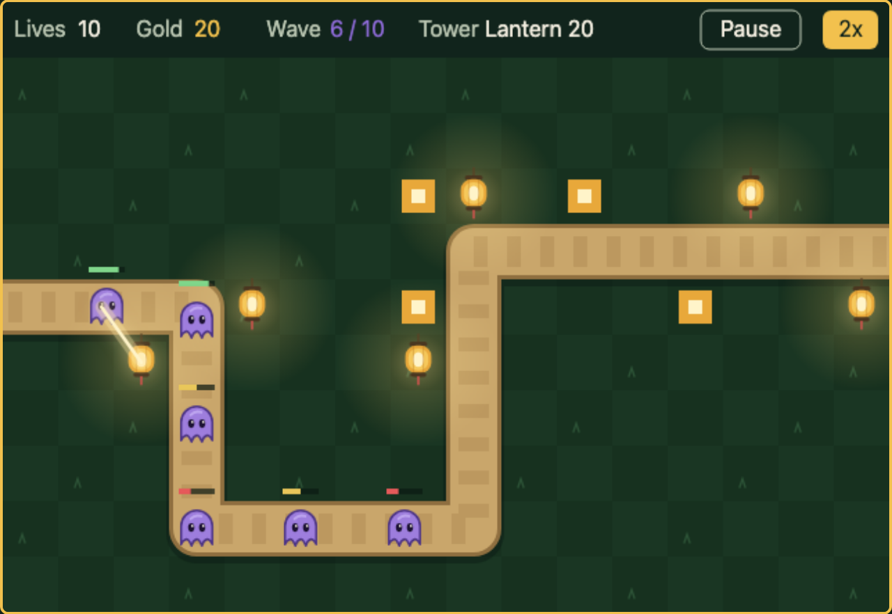

# Lantern Line



A small browser tower-defence game. Ghosts drift down a garden path; you hang
lanterns beside it, and each lantern throws a beam at the nearest ghost in reach.
Every ghost that reaches the far end costs a life.

Plain HTML, CSS and JavaScript modules on a canvas. No build step, no dependencies.

## Run it

Serve the folder and open the page (modules need http, not file://, in most browsers):

```sh
python3 -m http.server 8000   # then open http://localhost:8000
# or
npx serve .
```

Click any grass tile to place a lantern. Path tiles and taken tiles are refused.

## Test it

```sh
npm test        # runs node --test, Node 18 or later, nothing to install
```

## Layout

| File | What it holds |
| --- | --- |
| `src/path.js` | The grid, the fixed path, and moving a point along it |
| `src/enemy.js` | Creating a ghost and advancing it along the path |
| `src/targeting.js` | Range checks and choosing the nearest ghost in range |
| `src/tower.js` | The lantern tower, placement rules and its reload |
| `src/game.js` | Game state and the per-frame `step` |
| `src/render.js` | Canvas drawing only |
| `src/main.js` | Browser wiring: canvas, mouse, frame loop |
| `test/` | `node --test` tests of the pure modules |
| `work/` | Milestone work items, one markdown file per task |
| `design/hud.md` | Design brief for the HUD and start screen (M4 input) |

Everything except `render.js` and `main.js` is pure logic with no DOM, so it can
be tested directly in Node.

## What is not built yet

The game today is deliberately minimal: one lantern kills a ghost in one hit,
ghosts arrive forever at a fixed interval, and nothing happens at zero lives.
The `work/` folder holds the next milestones:

- **M1 Core loop**: enemy health, waves, win and lose with restart.
- **M2 Towers and targeting**: a splash tower, range on hover, first or nearest targeting.
- **M3 Waves and economy**: gold per kill, tower costs, a waves table.
- **M4 HUD and polish**: a HUD, pause and speed, a start screen (see `design/hud.md`).

## Gates

What blocks a change, and where. Nothing here waits on a person's click: a pull request
merges when its required checks are green.

- **Locally**, the hooks `make hooks` installs from `.githooks/` (refused in a worktree,
  whose hooks are its clone's). `pre-commit` refuses a file staged in part, then runs
  `make check`. `commit-msg` refuses a subject that is not a sentence starting with a
  capital letter. `pre-push` refuses a push straight to `staging` or `main`, then runs
  `make check`. Each fails closed. Never bypass them.
- **In CI**, `.github/workflows/ci.yml` runs the lanes on every pull request into
  `staging` and `main`, on every push to them and nightly. Every job has a timeout, every
  action is pinned by its commit, and every gate after `make deps` runs offline.
- **On the forge**, `rulesets.json` protects `staging` and `main`: a pull request is
  required with no approval, the `check` and `witnesses` jobs are required checks, and
  the branch can be neither deleted nor force-pushed, with no bypass actor.
